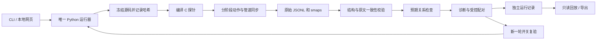

# 设计与实现

## 数据流

两套 C 探针共享 `common/probe.h`，不再通过重命名 main 包含另一份完整实验程序。两侧保护页隔离 VMA，smaps 按精确起止地址匹配；父子进程通过管道同步，在采样时保持目标区域不变。

旧 `run_pilot.py` 和 `run_thp.py` 只负责兼容调用，不再各自编译、解析和覆盖 results。运行器根据自身位置定位源码，不依赖当前工作目录。每轮先保存源码与环境，再编译冻结的 C 文件。Python 模块仍是启动时加载的版本：不应在运行中修改代码；源码哈希不是数字签名，不能作为防恶意篡改认证。

## 三层状态

1. 执行状态：编译/程序是否结束、是否超时或不支持。
2. 观测校验：原始数据是否完整，数值/隔离正确性是否成立，预期关系是否偏离。
3. 机制解释：只对具备证据前提的规则给结论，列出对应实验、阶段、指标和原文位置。

缺字段不当作零。采样缺失、重复、顺序错误、JSONL/smaps 不一致、源码或原始文件哈希不匹配都会阻止对应机制确认。`MADV_HUGEPAGE` 未观察到 AnonHugePages 不算程序错误。

## 诊断规则

| 规则 | 前提 | 结论等级 | 限制 |
| --- | --- | --- | --- |
| 只读零页解释 | 次缺页增加，目标 RSS/私有脏页为 0，无 THP | 可能原因 | 未采集 PFN/页错误路径 |
| COW 计账与隔离 | fork RSS/PSS 关系、改写后 PSS 与私有页关系、值校验、无大页/交换 | 已确认观测 | 不声称逐页复制事件 |
| 实际大页驻留 | smaps AnonHugePages > 0 | 已确认观测 | KernelPageSize 不能单独判断 |
| THP 未观测到 | 请求 on，采样 AnonHugePages=0 | 原因证据不足 | 不断言碎片或内存不足 |
| THP 配对 | 同轮、同重复编号、同模式/尺寸/步长/对齐；实际驻留不同；校验通过 | 已确认受控差异 | 不推断耗时、吞吐或实机性能 |

同轮 THP 对照交替运行开/关顺序。对照复验创建新的运行记录，保存父报告 ID 与 SHA256，不混合两轮指标做因果确认。核心机制解释不依赖在线大模型。

## 可调 COW 对照

`cow.py` 集中保存允许的五种比例与页间隔，运行器将选择展开成独立案例。C 探针记录声明条件和实际写入次数；解析器同时核对计划、页尺寸、总页数、页间隔与实际计数。新探针在求和之外检查父子每个基础页的页首字节，减少不同错误互相抵消而校验和仍相同的盲点。它没有校验页内每一个字节。

父进程写满 M 字节区域后 fork，在关闭 THP、无交换、只有父子共享该区域并同步采样的条件下，子进程改写 n 个 B 字节基础页，父子区域 PSS 合计预计约为 M+nB。两侧私有脏页均预计为 nB，共享脏页均预计为 M−nB；不只用 PSS 一个数确认。实际精度受基础页和计账单位限制，规则与样本均保留具体页尺寸。

零写入作为共享对照单独解释。五种比例分别判断，不将不同机器或不同轮次的值拼接为一次受控实验。网页表格按同一轮、尺寸和重复编号展示可用条件；完整五组需要执行全部比例。COW 按钮创建新实验，但当前不声明它与所选历史构成正式父子复验关系；THP 的父报告关联机制保持原有语义。

## 故障保留

子进程原始字节直接写文件；timeout 杀 Linux 进程组，防止 fork 子进程继续阻塞。每个阶段原子更新 report。外部 kill -9、断电或存储不可写可能使最后检查点仍为 running；回放不能把它称为成功完成。工作台任务日志独立保存于 `output/server-jobs`。

VM 每次使用独立传输目录，白名单打包，失败也尝试取回新目录；拒绝覆盖已有 guest-runs。重跑不复制历史所有运行，也不依赖上一轮客体源码。宿主机与客体可能存在时钟偏差，传输记录同时保留宿主机时间和客体 preflight 日志；禁止依靠跨机器时间戳排序推断先后。

## 本地页面

Python 标准库 HTTP 服务只监听 127.0.0.1。静态 HTML/CSS/ES module 无构建依赖，适合离线实验环境。读接口限定已登记实验根目录及指定原始文件；执行接口检查 Host、同源 Origin 和随机会话 token，不接受任意 shell 命令。一次只能执行一个页面任务。展示层不生成替代实验数据。

当前无任务取消按钮；不要在实验执行中关闭服务。超时保护与错误日志已实现，但远程 SSH 连接中断后进程清理仍需更深入测试。

## 课程 malloc 观察

`proj5-course/allocator_probe.c` 独立保存完整进程 smaps，使用低层 I/O 和静态缓冲减少观察器额外分配。它复用统一编译、进程执行、源码快照、失败状态、回放和导出流程，不复用隔离 VMA 探针的“目标区域必须恰好一个 VMA”假设。

`allocator.py` 按实际申请地址区间选出相交 VMA，保留各段并合计指标，scope 明确为 overlapping_vmas；声明条件和写入位置需要与计划一致。校验值错误与机制解释分开，不能因小块已经驻留或 free 后映射仍在就报机制失败。course 先分流到对应诊断，避免误进入 THP 对照分支。课程页面每步只读取一个保存的样本，按钮发起的新任务使用相同统一入口。

## v0.4 教学任务和进程策略控制

课程采样主程序通过小型头文件调用访问循环。默认 reference 为 `proj5-course/access_pattern.h`；学生版为 `lessons/demand/student.h`，统一运行器以受限选项选择编译，两个文件均进入源码白名单和每轮快照。页面不接受任意编译命令，不覆盖学生文件。任务自动检查累计位置与最终值，不能单靠计数证明从未重写旧位置；完整实现仍需代码审阅，不是任意 C 代码的正确性或内存安全证明。

THP 探针使用 PR_SET_THP_DISABLE 的普通全禁用模式（flags=0），不使用新内核才有的 EXCEPT_ADVISED。`thp_policy.py` 单独承担原始进程状态交叉校验与同轮干预配对。原有 VMA 建议开/关配对同时匹配进程策略，避免混组。缺少新字段的历史记录不会获得虚构的策略证明。

`/lesson` 和 `/lesson.js` 复用同一任务锁、运行器、证据目录和只读报告接口；`student` 发起学生编译检查，`policy`/`policy-recheck` 发起进程策略实验。草稿和回答只在本地浏览器，需主动导出备份；尚无导入、账户或教学评分系统。普通页面使用 learner_notes；`?verification=1` 单独标记页面测试数据。历史目录列表附 suites，课程页只显示包含课程案例的记录。

## v0.5 地址与映射

`layout_probe.c` 以 PIE 编译，使用 dl_iterate_phdr 采集已加载 PT_LOAD，以 dlsym 取得 libc malloc 的实际地址，避免把主程序的 PLT 跳转地址当作库实现。程序记录七个地址与完整自身 smaps；`layout.py` 将地址、映射与段关联，分别处理证据失败和权限偏差。BSS 匿名尾部和一个段跨多条 VMA 均保留真实结构。

完整 smaps 解析抽到 `smaps.py`，malloc 与 layout 共用。运行、回放、诊断、页面任务锁及导出仍经过原统一流程，新增 `--suite layout`，默认 all 包含三次地址案例。页面先显示一个课程问题，详细对应表与段表折叠；不采集 PFN，不变更系统随机化配置。
