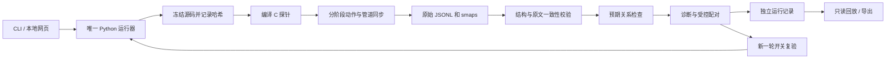

# 设计与实现

## 数据流

两套 C 探针共享 `common/probe.h`，不再通过重命名 main 包含另一份完整实验程序。两侧保护页隔离 VMA，smaps 按精确起止地址匹配；父子进程通过管道同步，在采样时保持目标区域不变。

旧 `run_pilot.py` 和 `run_thp.py` 只负责兼容调用，不再各自编译、解析和覆盖 results。运行器根据自身位置定位源码，不依赖当前工作目录。每轮先保存源码与环境，再编译冻结的 C 文件。Python 模块仍是启动时加载的版本：不应在运行中修改代码；源码哈希不是数字签名，不能作为防恶意篡改认证。

## 三层状态

1. 执行状态：编译/程序是否结束、是否超时或不支持。
2. 观测校验：原始数据是否完整，数值/隔离正确性是否成立，预期关系是否偏离。
3. 机制解释：只对具备证据前提的规则给结论，列出对应实验、阶段、指标和原文位置。

缺字段不当作零。采样缺失、重复、顺序错误、JSONL/smaps 不一致、源码或原始文件哈希不匹配都会阻止对应机制确认。`MADV_HUGEPAGE` 未观察到 AnonHugePages 不算程序错误。

## 诊断规则

| 规则 | 前提 | 结论等级 | 限制 |
| --- | --- | --- | --- |
| 只读零页解释 | 次缺页增加，目标 RSS/私有脏页为 0，无 THP | 可能原因 | 未采集 PFN/页错误路径 |
| COW 计账与隔离 | fork RSS/PSS 关系、改写后 PSS 与私有页关系、值校验、无大页/交换 | 已确认观测 | 不声称逐页复制事件 |
| 实际大页驻留 | smaps AnonHugePages > 0 | 已确认观测 | KernelPageSize 不能单独判断 |
| THP 未观测到 | 请求 on，采样 AnonHugePages=0 | 原因证据不足 | 不断言碎片或内存不足 |
| THP 配对 | 同轮、同重复编号、同模式/尺寸/步长/对齐；实际驻留不同；校验通过 | 已确认受控差异 | 不推断耗时、吞吐或实机性能 |

同轮 THP 对照交替运行开/关顺序。对照复验创建新的运行记录，保存父报告 ID 与 SHA256，不混合两轮指标做因果确认。核心机制解释不依赖在线大模型。

## 故障保留

子进程原始字节直接写文件；timeout 杀 Linux 进程组，防止 fork 子进程继续阻塞。每个阶段原子更新 report。外部 kill -9、断电或存储不可写可能使最后检查点仍为 running；回放不能把它称为成功完成。工作台任务日志独立保存于 `output/server-jobs`。

VM 每次使用独立传输目录，白名单打包，失败也尝试取回新目录；拒绝覆盖已有 guest-runs。重跑不复制历史所有运行，也不依赖上一轮客体源码。宿主机与客体可能存在时钟偏差，传输记录同时保留宿主机时间和客体 preflight 日志；禁止依靠跨机器时间戳排序推断先后。

## 本地页面

Python 标准库 HTTP 服务只监听 127.0.0.1。静态 HTML/CSS/ES module 无构建依赖，适合离线实验环境。读接口限定已登记实验根目录及指定原始文件；执行接口检查 Host、同源 Origin 和随机会话 token，不接受任意 shell 命令。一次只能执行一个页面任务。展示层不生成替代实验数据。

当前无任务取消按钮；不要在实验执行中关闭服务。超时保护与错误日志已实现，但远程 SSH 连接中断后进程清理仍需更深入测试。
